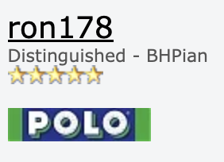
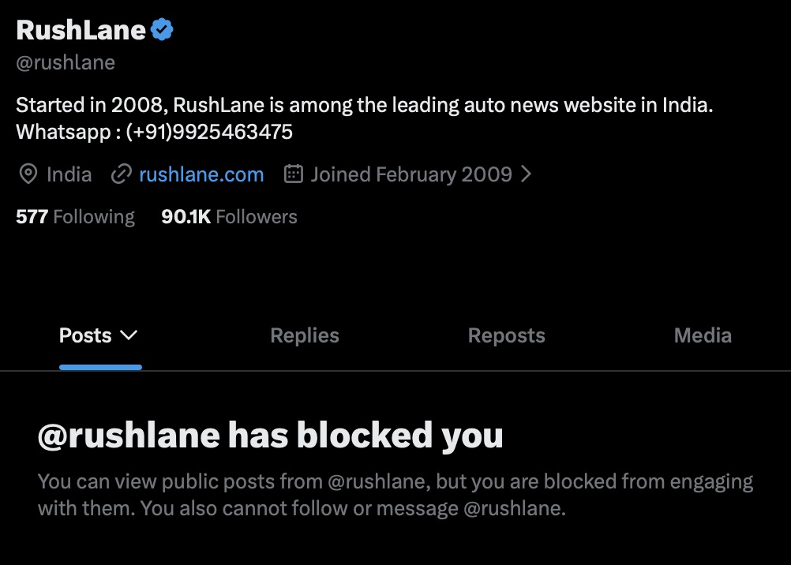

The Yawning Chihuahua is an anonymous Internet persona with an interest in cars, and an emphasis on vehicle safety regulations and consumer tests in India as well as around the world.

# Internet accounts
- [X (formerly Twitter)](https://x.com/theyawninchihua)
- [YouTube](https://youtube.com/@theyawninchihua)
- [Team-BHP](https://www.team-bhp.com/forum/members/ron178.html)
- [Instagram](https://instagram.com/theyawninchihua)
- [GitHub](https://github.com/theyawninchihua)
- [email](mailto:theyawningchihuahua@gmail.com)

# Recognition
- In June 2025, The Yawning Chihuahua was featured on the #DeepDrive podcast by Autocar India magazine, India's leading automotive publication.

  > "[A] sane and knowledgeable [voice] in an ocean of self-appointed experts" — **Hormazd Sorabjee**, Editor, Autocar India ([link](https://x.com/hormazdsorabjee/status/1936339305363898788))

  <iframe width="560" height="315" src="https://www.youtube.com/embed/PMCPRjlHgCo?si=x5D4Bs6OLByPVo5r&amp;start=1133" title="YouTube video player" frameborder="0" allow="accelerometer; autoplay; clipboard-write; encrypted-media; gyroscope; picture-in-picture; web-share" referrerpolicy="strict-origin-when-cross-origin" allowfullscreen></iframe>

- In July 2025, the creator of The Yawning Chihuahua was recognised as "Distinguished BHPian" by Team-BHP, India's largest automotive forum, for contributions to the community.

  

- The Yawning Chihuahua's strong preference of facts over *[faits divers](https://www.collinsdictionary.com/dictionary/english/faits-divers)* has been validated by its X (formerly Twitter) account being blocked by the automotive tabloid Rush Lane.

  

—TYC

[Back to home](../)
