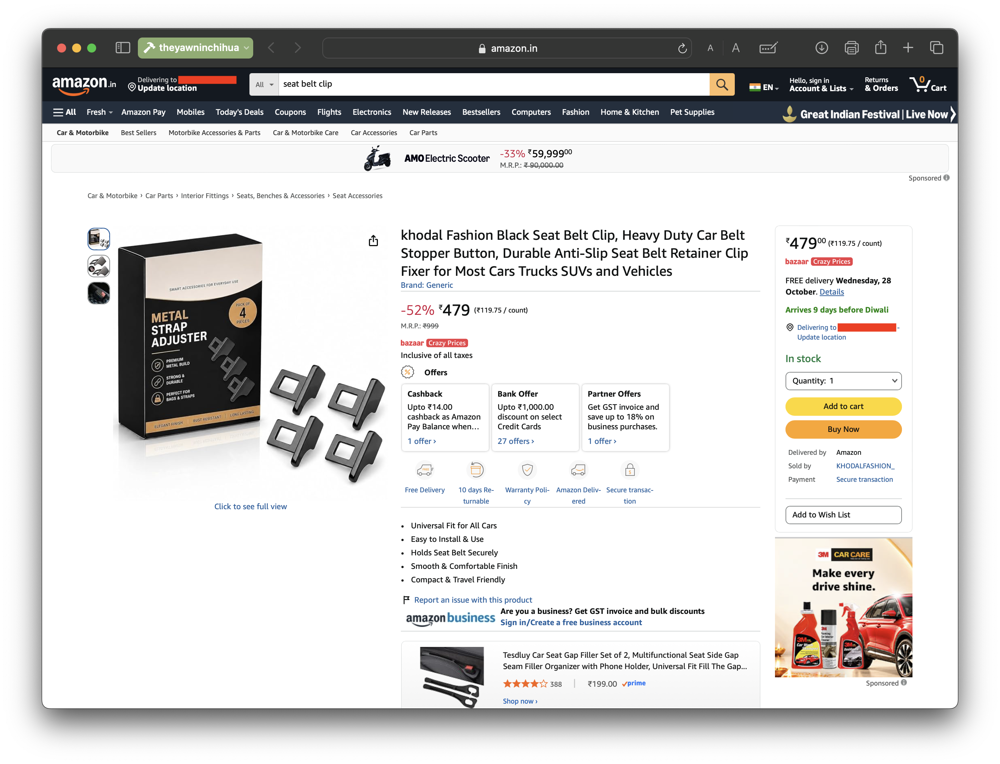
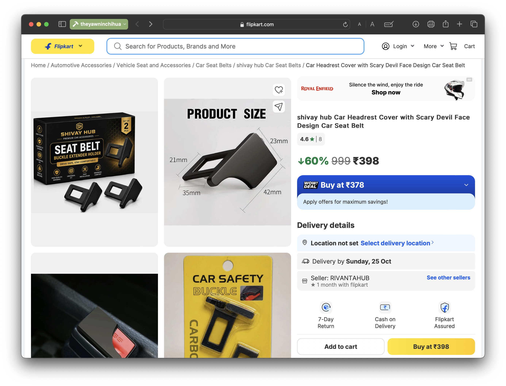
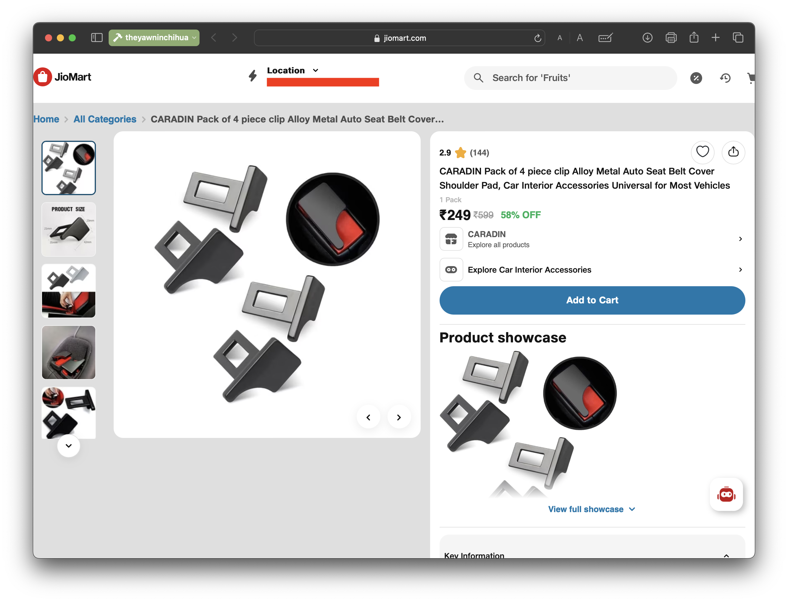
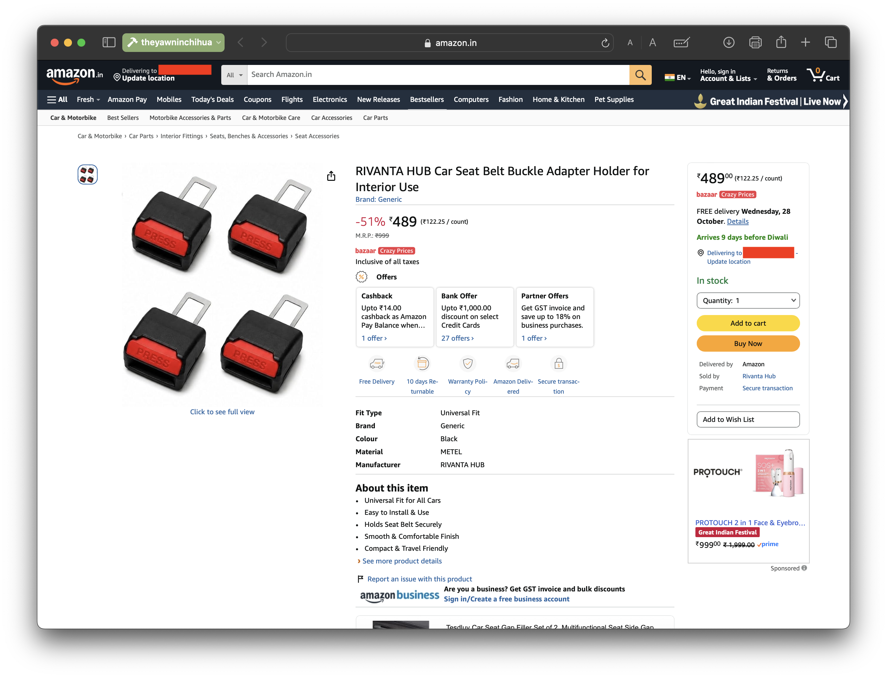

**22.10.2026**

Three years after the CCPA directed e-commerce platforms to delist them, clips to defeat the seatbelt reminder system in vehicles are still being sold by major online retailers in India under alternative names, a series of searches by the Yawning Chihuahua reveals.

In May 2023, [the Central Consumer Protection Authority (CCPA) directed](https://www.pib.gov.in/PressReleaseIframePage.aspx?PRID=1923591&lang=2&reg=48) major e-commerce platforms to permanently delist seatbelt alarm stopper clips and associated components that compromise passenger safety. Seatbelt reminder defeat clips not only prevent the functioning of the seatbelt reminder system, but also require drivers and passengers to first remove the clip before they can fasten their seatbelt normally.

## Searches reveal the clips still on sale
The Yawning Chihuahua conducted searches on major e-commerce platforms in India for seatbelt reminder defeat clips, using terms such as "seatbelt alarm clip", "seatbelt sound stopper" and more. The searches returned products that appeared capable of defeating the seatbelt reminder, although their listings did not describe them as alarm-stopper clips.

### Clips sold under unrelated inconspicuous names
This [listing on Amazon India](https://www.amazon.in/dp/B0HNS7HXK7), for example, shows a seatbelt clip described as an **anti-slip seatbelt retainer clip**. However, it has a seatbelt tongue, which is inconsistent with the description of an anti-slip retainer clip, which would typically sit on the shoulder belt.

Another [listing on Flipkart](https://www.flipkart.com/shivay-hub-car-headrest-cover-scary-devil-face-design-seat-belt/p/itm9c60f29598287) shows a clip with a seatbelt tongue labelled a **headrest cover**.

Images of this **seat belt cover shoulder pad** on [JioMart](https://www.jiomart.com/product/caradin-pack-of-4-piece-clip-alloy-metal-auto-seat-belt-cover-shoulder-pad-car-interior-accessories-universal-for-most-vehicles-mq9bk8-109108800?source=shoppingads) reveal it plugs into a seatbelt buckle, and it does not appear to be a pad for the shoulder belt.

### Safety of third-party seatbelt extenders remains a question mark
This [third-party seatbelt extender on Amazon India](https://www.amazon.in/dp/B0HN28YTZP/) has a buckle that appears to allow seatbelt use while still defeating the seatbelt reminder system by keeping the vehicle's buckle engaged even when the seatbelt is not worn. These extenders are sometimes marketed as solutions for easier belt use for some occupants, like pregnant women.

The product listing does not specify certification to any Indian or global (e.g. UNECE) regulation. The Yawning Chihuahua could not identify any relevant Indian or UNECE safety regulations under which seatbelt extenders have to be crash tested, or any endorsement of third-party extenders by vehicle manufacturers.

Independent [crash testing by the German consumer organisation ADAC of some third-party seatbelt extenders sold in Germany](https://www.adac.de/rund-ums-fahrzeug/ausstattung-technik-zubehoer/ausstattung/schwangerschaftsgurte-auto/) showed that the tested adapters did not reduce pelvic loads, and instead worsened restraint. The plastic anchorages in some of the tested adapters broke during testing.

<iframe width="560" height="315" src="https://www.youtube.com/embed/sK3JN7ml2Lg?si=aPMwUeUNF5HalBhF" title="YouTube video player" frameborder="0" allow="accelerometer; autoplay; clipboard-write; encrypted-media; gyroscope; picture-in-picture; web-share" referrerpolicy="strict-origin-when-cross-origin" allowfullscreen></iframe>

## External links
- [PIB: CCPA directs e-commerce platforms to delist seatbelt alarm stopper clips](https://www.pib.gov.in/PressReleaseIframePage.aspx?PRID=1923591&lang=2&reg=48)
- [ADAC: Pregnancy seat belt adapters tested: None deliver what they promise](https://www.adac.de/rund-ums-fahrzeug/ausstattung-technik-zubehoer/ausstattung/schwangerschaftsgurte-auto/)
- [Amazon India (clip 1)](https://www.amazon.in/dp/B0HNS7HXK7/)
- [Amazon India (clip 2)](https://www.amazon.in/RIVANTA-Wear%E2%80%91Resistant-Anti%E2%80%91Slip-Retainer-Vehicles/dp/B0HN224M2H/)
- [Amazon India (extender)](https://www.amazon.in/dp/B0HN28YTZP/)
- [Flipkart](https://www.flipkart.com/shivay-hub-car-headrest-cover-scary-devil-face-design-seat-belt/p/itm9c60f29598287)
- [JioMart](https://www.jiomart.com/product/caradin-pack-of-4-piece-clip-alloy-metal-auto-seat-belt-cover-shoulder-pad-car-interior-accessories-universal-for-most-vehicles-mq9bk8-109108800)

-TYC

[click to go back to articles](../)
