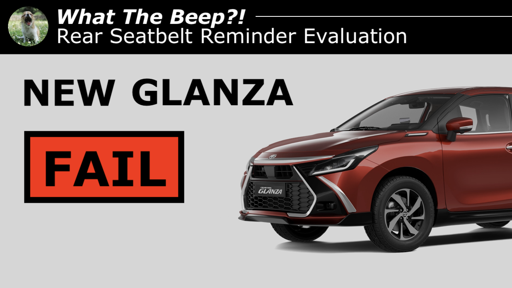
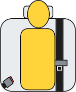
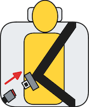
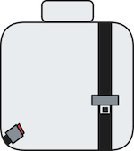
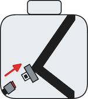

**15.10.2026**

The facelifted [GLANZA](../../whatthebeep/2026-10-15-GLANZA-E/) from Toyota was launched yesterday, and today, a [#WhatTheBeep](../../whatthebeep/) seatbelt reminder evaluation for it has been published based on desktop research of its owners' manual.

Like its corporate twin the Maruti Suzuki Baleno [evaluated last month](../N202609081/), the [GLANZA](../../whatthebeep/2026-10-15-GLANZA-E/)'s rear seatbelt reminder receives a **FAIL** result under the simple [#WhatTheBeep](../../whatthebeep/) criteria.

## Toyota GLANZA evaluation explained

Despite having a rear seatbelt reminder, the rear seats of the [GLANZA](../../whatthebeep/2026-10-15-GLANZA-E/) do not have any meaningful occupant detection. Like most such cars, it relies solely on change of belt status, starting its secondary audible signal only when a rear seatbelt *changes status to* unfastened during a drive.

This means the [GLANZA](../../whatthebeep/2026-10-15-GLANZA-E/) fails to audibly alert rear occupants who have been unbelted from the start (likely the majority of unbelted occupants). It can also falsely alert if a belt is taken off on an empty seat (for instance, if an outboard occupant accidentally attempts to use the centre buckle). Both of these individually are sufficient conditions for a **FAIL** under the [#WhatTheBeep](../../whatthebeep/) evaluation criteria.

## [Toyota GLANZA](../../whatthebeep/2026-10-15-GLANZA-E/)
**Behaviour of second-level warning in the 2nd-row outboard seats**

| Testcase | Description | Audible warning | Verdict |
| --- | --- | --- | --- |
|  | occupant does not fasten seatbelt | **NO** | **NOT OK** |
|  | occupant takes off seatbelt | **YES** | **OK** |
|  | seatbelt not fastened on an empty seat | **NO** | **OK** |
|  | seatbelt taken off on an empty seat | **YES** | **NOT OK** |
|  |  |  | **FAIL** |

More information about results, datasheets, sources of information, and evaluation criteria are at the following links:

- [All you need to know about #WhatTheBeep](../../whatthebeep/)
- [Datasheet for Toyota GLANZA](../../whatthebeep/2026-10-15-GLANZA-E/)

-TYC

[click to go back to articles](../)
