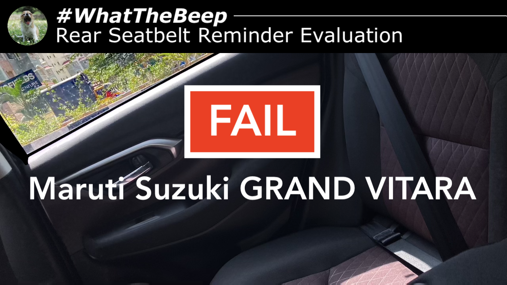

**30.10.2026**

The [Maruti Suzuki GRAND VITARA](../../whatthebeep/2026-10-30-GRANDVITARA-DeltaSCNG/) has been awarded **FAIL** in a new [#WhatTheBeep seatbelt reminder evaluation](../../whatthebeep/).

## Maruti Suzuki GRAND VITARA evaluation explained

In-person testing revealed that the rear seatbelt reminder of the [Maruti Suzuki GRAND VITARA](../../whatthebeep/2026-10-30-GRANDVITARA-DeltaSCNG/) does not start its intermediate/final signal when an a rear occupant has not buckled up. It only does so when a seatbelt that was already fastened is then taken off, in order to avoid false alerts on empty seats since **its rear seats do not have occupant detection**.

The [GRAND VITARA](../../whatthebeep/2026-10-30-GRANDVITARA-DeltaSCNG/) hence fails two [#WhatTheBeep testcases](../../whatthebeep/protocol.html), earning an overall **FAIL**.

<iframe width="560" height="315" src="https://www.youtube.com/embed/xxY9YpWAPd8?si=PN_kbhzBnz16P-ll" title="YouTube video player" frameborder="0" allow="accelerometer; autoplay; clipboard-write; encrypted-media; gyroscope; picture-in-picture; web-share" referrerpolicy="strict-origin-when-cross-origin" allowfullscreen></iframe>

## [Maruti Suzuki GRAND VITARA](../../whatthebeep/2026-10-30-GRANDVITARA-DeltaSCNG/)
**Behaviour of second-level warning in the 2nd-row outboard seats**

| Testcase | Description | Audible warning | Verdict |
| --- | --- | --- | --- |
|  | occupant does not fasten seatbelt | **NO** | **NOT OK** |
|  | occupant takes off seatbelt | **YES** | **OK** |
|  | seatbelt not fastened on an empty seat | **NO** | **OK** |
|  | seatbelt taken off on an empty seat | **YES** | **NOT OK** |
|  |  |  | **FAIL** |

More information about results, datasheets, sources of information, and evaluation criteria are at the following links:

- [All you need to know about #WhatTheBeep](../../whatthebeep/)
- [Datasheet for Maruti Suzuki GRAND VITARA](../../whatthebeep/2026-10-30-GRANDVITARA-DeltaSCNG/)

-TYC

[click to go back to articles](../)
