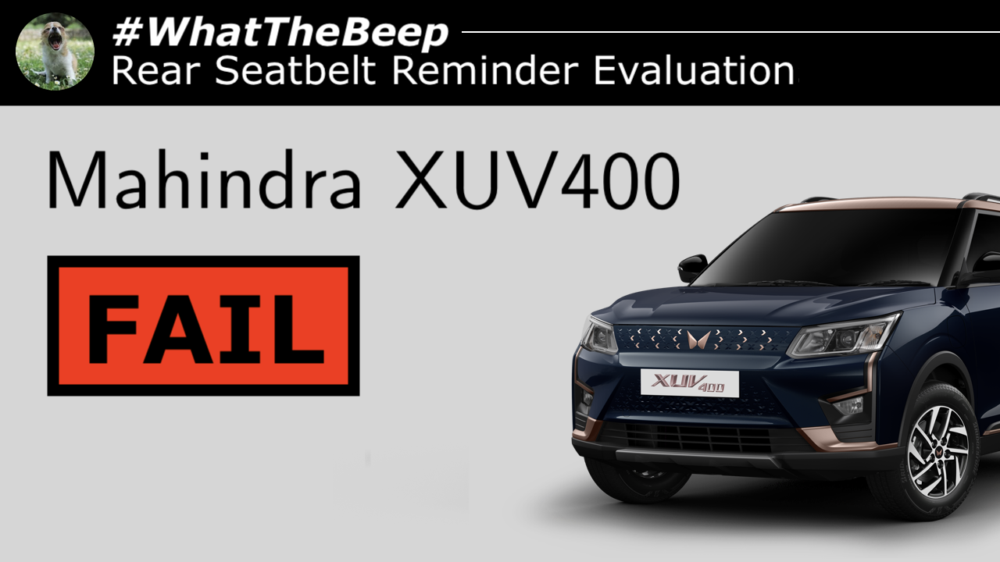

**05.11.2026**

The [Mahindra XUV400](../../whatthebeep/2026-11-05-XUV400-ECPro35kWh/) has been awarded **FAIL** in a new [#WhatTheBeep seatbelt reminder evaluation](../../whatthebeep/).

Mahindra have demonstrated in previous #WhatTheBeep evaluations that, when they do fit rear seatbelt reminders to their models, they are proper systems with occupant detection and timely audible warnings. It remains a disappointment that the XUV400, popular in premium fleets, continues to be sold without any form of rear seatbelt reminder.

## Mahindra XUV400 evaluation explained

In-person testing revealed that the [Mahindra XUV400](../../whatthebeep/2026-11-05-XUV400-ECPro35kWh/) does not have a rear seatbelt reminder, confirmed by inspection of its user manual and brochure.

<iframe width="560" height="315" src="https://www.youtube.com/embed/v0t6KQEfjKY?si=D0f_IU5qSvqDx1sg" title="YouTube video player" frameborder="0" allow="accelerometer; autoplay; clipboard-write; encrypted-media; gyroscope; picture-in-picture; web-share" referrerpolicy="strict-origin-when-cross-origin" allowfullscreen></iframe>

## [Mahindra XUV400](../../whatthebeep/2026-11-05-XUV400-ECPro35kWh/)
**Behaviour of second-level warning in the 2nd-row outboard seats**

| Testcase | Description | Audible warning | Verdict |
| --- | --- | --- | --- |
|  | occupant does not fasten seatbelt        | **NO**        | **NOT OK** |
|  | occupant takes off seatbelt              | **NO**        | **NOT OK** |
|  | seatbelt not fastened on an empty seat   | **NO**      | **OK**   |
|  | seatbelt taken off on an empty seat      | **NO**      | **OK**   |
|  |  |  | **FAIL** |

More information about results, datasheets, sources of information, and evaluation criteria are at the following links:

- [All you need to know about #WhatTheBeep](../../whatthebeep/)
- [Datasheet for Mahindra XUV400](../../whatthebeep/2026-11-05-XUV400-ECPro35kWh/)

-TYC

[click to go back to articles](../)
