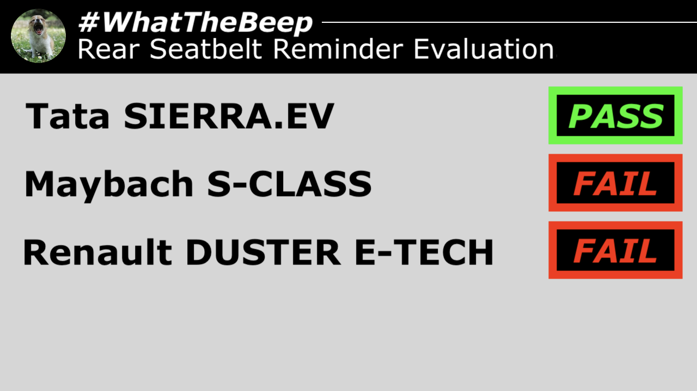
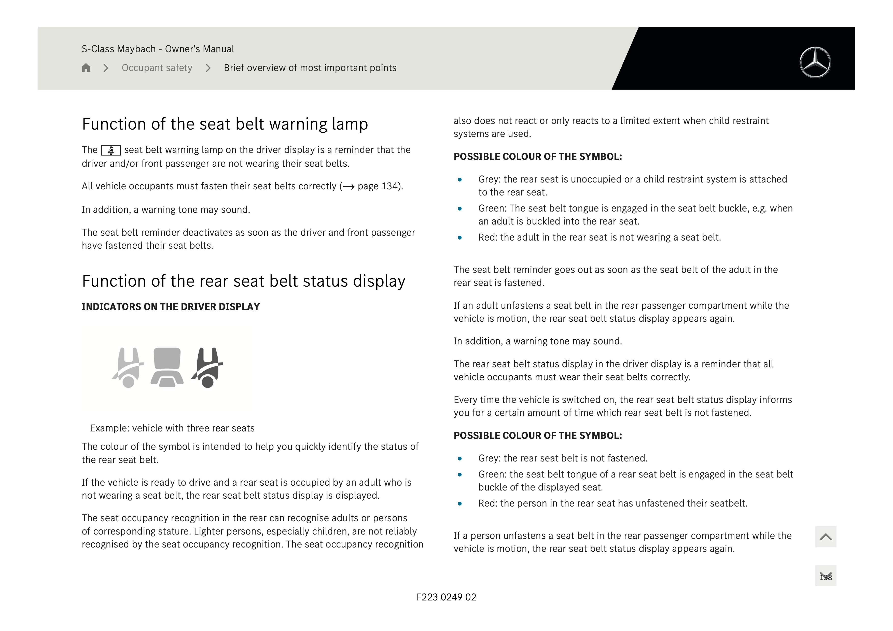
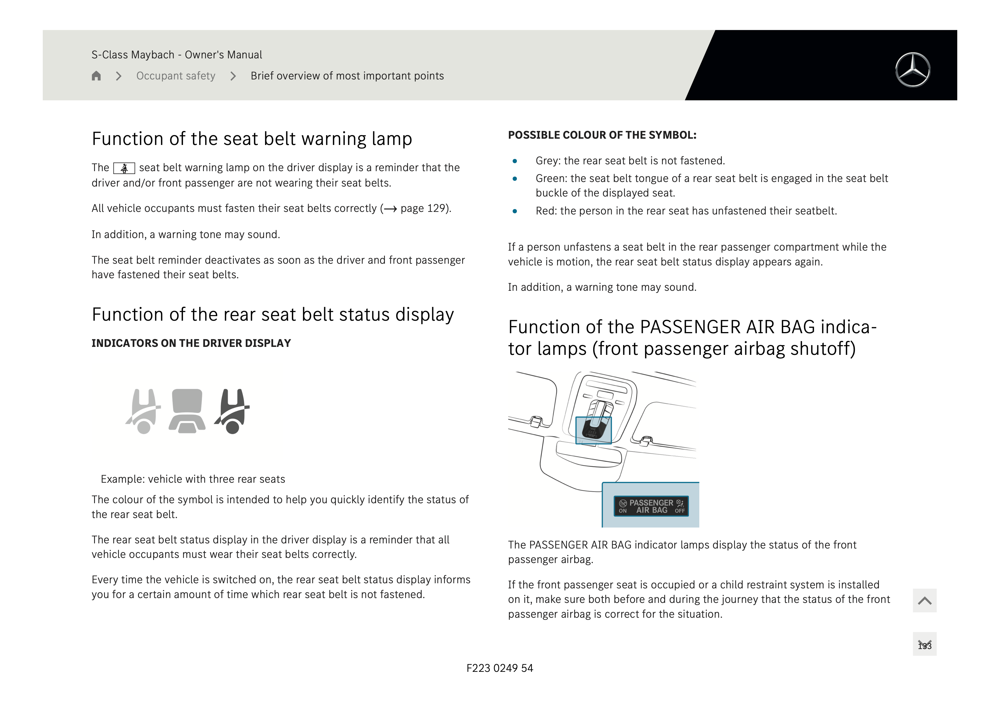

**14.11.2026**

Today, The Yawning Chihuahua releases [#WhatTheBeep](../../whatthebeep/) evaluations for more vehicles recently launched into the Indian market, based on desktop research. The facelifted [Mercedes-Maybach S-CLASS](../../whatthebeep/2026-11-14-SCLASS-S580e/) receives **FAIL**, with its documentation revealing a regional downgrade in the rear seatbelt reminder fitted to the Indian model. The electric [Tata SIERRA.EV](../../whatthebeep/2026-11-14-SIERRAEV-Pure63kWhRWD/) receives a **PASS**, also based on its documentation.

## India-spec Maybach S-Class evaluation explained
With its long-running reputation for rear-seat comfort, the [Mercedes-Maybach S-CLASS](../../whatthebeep/2026-11-14-SCLASS-S580e/) was facelifted in the Indian market last month, and has state-of-the-art passive safety features in the rear seat, like frontal airbags in the seatbacks, and inflatable rear seatbelts.

However, like the majority of Indian-market cars, **the India-spec Maybach [S-CLASS](../../whatthebeep/2026-11-14-SCLASS-S580e/) skips occupant detection sensors in the rear seats. Despite having a rear seatbelt reminder,** the Indian model of [S-CLASS](../../whatthebeep/2026-11-14-SCLASS-S580e/) will not warn if a rear occupant has never buckled up on the trip.

The India-spec Maybach [S-CLASS](../../whatthebeep/2026-11-14-SCLASS-S580e/) hence fails two [#WhatTheBeep testcases](../../whatthebeep/protocol.html), and receives a **FAIL**.

### Overseas S-Class models have superior rear seatbelt reminder
A side-by-side comparison of documentation for the India-spec [S-CLASS](../../whatthebeep/2026-11-14-SCLASS-S580e/) with [that of the British-market model](https://www.mercedes-benz.co.uk/passengercars/owners-manuals/en-gb/pdf/mercedes-maybach-s-class-saloon-2026-december-z223-mbux-owners-manual-1.pdf) reveals regional differences in their rear seatbelt reminder systems.

|   | British-market S-CLASS | India-spec S-CLASS |
| - | ---------------------- | ------------------ |
| Rear seatbelt reminder | Yes | Yes |
| Rear occupant detection | Yes | No |
| Final signal activates when... | "the adult in the rear seat is not wearing a seat belt" | "the person in rear seat has *unfastened* their seatbelt" |
| Documentation |  | |

## Tata achieves **PASS** with enhanced system in SIERRA.EV
In contrast, the [Tata SIERRA.EV](../../whatthebeep/2026-11-14-SIERRAEV-Pure63kWhRWD/) receives a **PASS** for its rear seatbelt reminder system. Documentation reveals in multiple places that its rear seatbelt reminder starts its final **audio signal above a certain speed if an occupant is detected whose belt is not fastened**.

> **NOTE**  
> The evaluation is not valid for the related combustion-powered Tata SIERRA

## Renault DUSTER evaluation result confirmed for new hybrid DUSTER E-TECH
The [Renault DUSTER E-TECH](../../whatthebeep/2026-11-14-DUSTERETECH-evolutionETech160/) receives a **FAIL**, mirroring its petrol-powered namesake [evaluated earlier this year](../N202604031/).

More information about results, datasheets, sources of information, and evaluation criteria are at the following links:

- [All you need to know about #WhatTheBeep](../../whatthebeep/)
- [Datasheet for Mercedes-Maybach S-CLASS](../../whatthebeep/2026-11-14-SCLASS-S580e/)
- [Datasheet for Tata SIERRA.EV](../../whatthebeep/2026-11-14-SIERRAEV-Pure63kWhRWD/)
- [Datasheet for Renault DUSTER E-TECH](../../whatthebeep/2026-11-14-DUSTERETECH-evolutionETech160/)

-TYC

[click to go back to articles](../)
