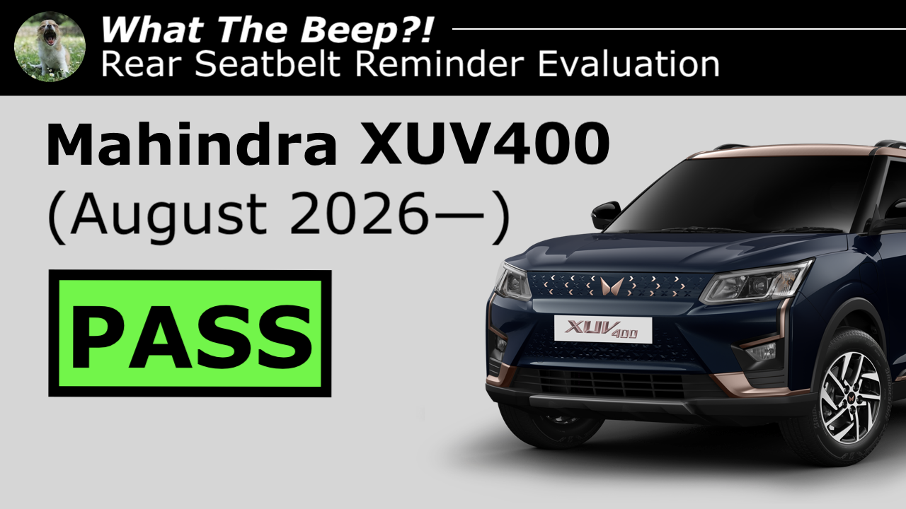
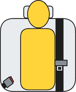
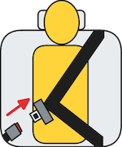
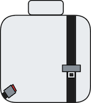
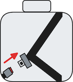

**20.11.2026**

Today, The Yawning Chihuahua is publishing a fresh [#WhatTheBeep](../../whatthebeep/) evaluation for the [Mahindra XUV400](../../whatthebeep/2026-11-20-XUV400-ECPro35kWh/) electric SUV, based on desktop research using its updated owners' manual.

## Error revealed in previous XUV400 evaluation

Earlier this month, The Yawning Chihuahua published a [#WhatTheBeep](../../whatthebeep/) evaluation for the [Mahindra XUV400](../../whatthebeep/2026-11-05-XUV400-ECPro35kWh/) and an [accompanying article](../N202611051/), based on a finding that the vehicle did not have a rear seatbelt reminder. This finding was then considered as valid for XUV400 units on sale at the time of evaluation (November 2026) based on information published in the XUV400's owners' manual on Mahindra's website at the time.

The owners' manual on the website has since been updated, indicating retrospectively that **a rear seatbelt reminder has been fitted to the XUV400 since August 2026**. Since the [#WhatTheBeep protocol](../../whatthebeep/protocol.html) requires that the seatbelt reminder behaviour presented in the evaluation must apply to the vehicle on sale at the time of evaluation (November 2026, in this case), this constituted an error. According to the error policy, the [original evaluation](../../whatthebeep/2026-11-05-XUV400-ECPro35kWh/) has been taken down.

**The Yawning Chihuahua apologises to readers for the misinformation and will continue to take a best-effort approach towards avoiding errors to the extent possible.**

## Mahindra XUV400 (August 2026—) evaluation explained

With the update, the electric SUV today receives **PASS** in a new [#WhatTheBeep evaluation](../../whatthebeep).

With occupant detection in the second row, the latest [XUV400](../../whatthebeep/2026-11-20-XUV400-ECPro35kWh/) audibly alerts detected rear occupants when they haven't fastened their seatbelt, with a chime for 35 seconds. It passes all of the four [#WhatTheBeep testcases](../../whatthebeep/protocol.html), and is awarded an overall **PASS**.

**Behaviour of second-level warning in the 2nd-row outboard seats**

| Testcase                         | Description                            | Audible warning                             | Verdict                                     |
| -------------------------------- | -------------------------------------- | ------------------------------------------- | ------------------------------------------- |
|  | occupant does not fasten seatbelt      | **YES**  | **OK**   |
|  | occupant takes off seatbelt            | **YES**  | **OK**   |
|  | seatbelt not fastened on an empty seat | **NO**   | **OK**   |
|  | seatbelt taken off on an empty seat    | **NO**   | **OK**   |
|                                  |                                        |                                             | **PASS** |

More information about results, datasheets, sources of information, and evaluation criteria are at the following links:

- [All you need to know about #WhatTheBeep](../../whatthebeep/)
- [Datasheet for Mahindra XUV400](../../whatthebeep/2026-11-20-XUV400-ECPro35kWh/)

-TYC

[click to go back to articles](../)
