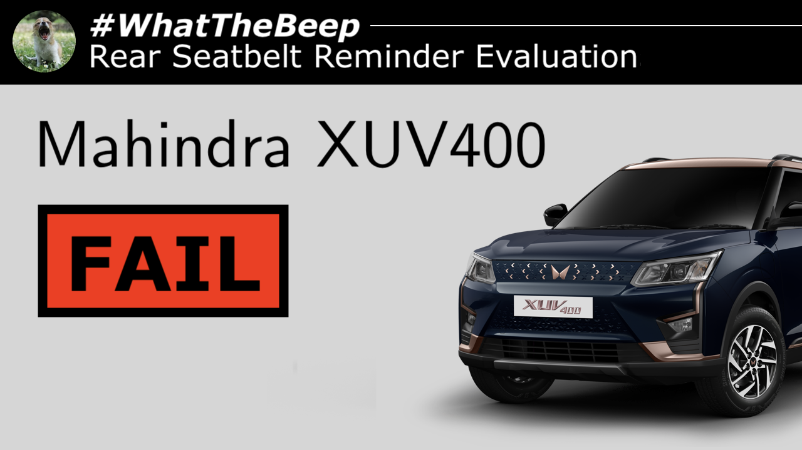
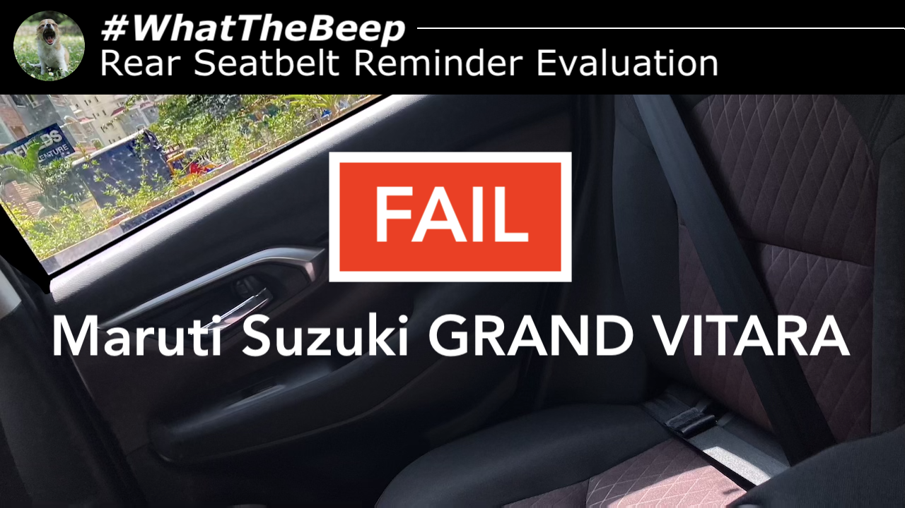
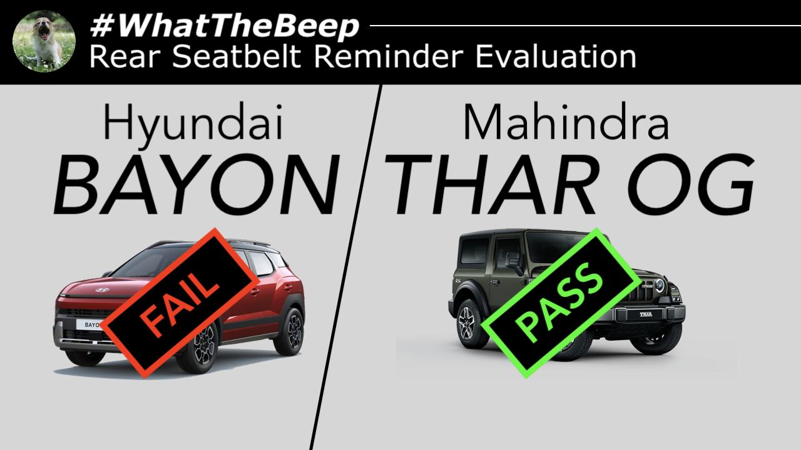
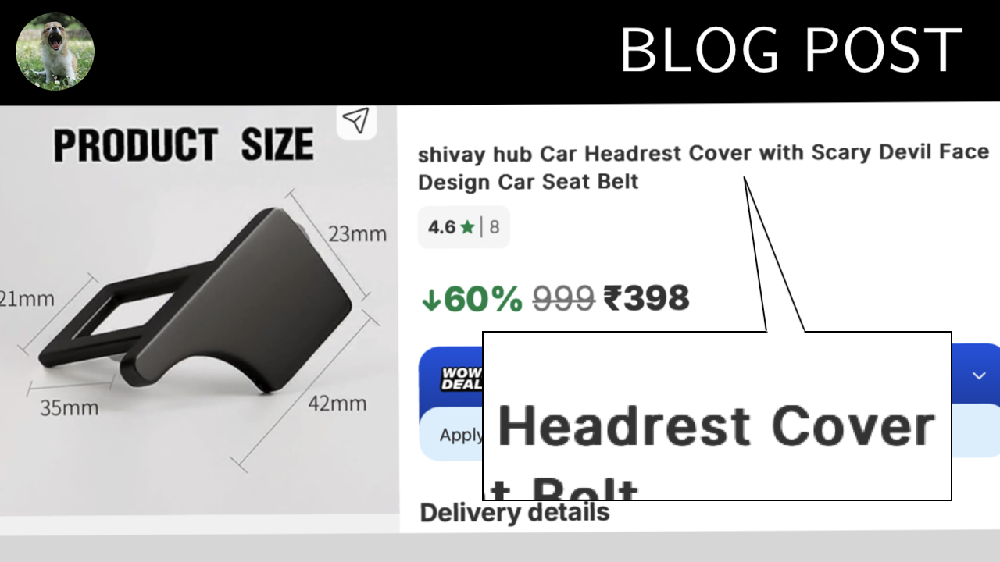

## Latest articles

05.11.2026 **NOTICE** • [Mahindra XUV400 remains on sale without rear seatbelt reminder](articles/N202611051/)

| | | |
| --- | --- | --- |
| 30.10.2026 **NOTICE** • [Grand Vitara fails #WhatTheBeep.](articles/N202610301/) | 27.10.2026 **NOTICE** • [Ahead of AEB mandate for Indian cars, simple safety features like rear seatbelt reminders still have room for improvement](articles/N202610271/) | 22.10.2026 **BLOG POST** • [Seatbelt reminder defeat clips continue to be sold under alternative names on India's e-commerce platforms](articles/B202610221/) |

[View more](articles/)

## Latest #WhatTheBeep results

27.11.26 [**PASS**] [Tata SIERRA.EV (*)](whatthebeep/2026-11-27-SIERRAEV-Pure63kWhRWD/)

27.11.26 [**FAIL**] [Renault DUSTER E-TECH (*)](whatthebeep/2026-11-27-DUSTERETECH-evolutionETech160/)

27.11.26 [**FAIL**] [Mercedes-Maybach S-CLASS (*)](whatthebeep/2026-11-27-SCLASS-S580e/)

05.11.26 [**FAIL**] [Mahindra XUV400](whatthebeep/2026-11-05-XUV400-ECPro35kWh/)

[View more](whatthebeep/)
