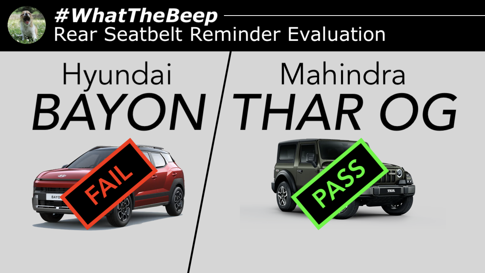

## Latest articles

30.10.2026 **NOTICE** • [Grand Vitara fails #WhatTheBeep.](articles/N202610301/)

| | | |
| --- | --- | --- |
| 27.10.2026 **NOTICE** • [Ahead of AEB mandate for Indian cars, simple safety features like rear seatbelt reminders still have room for improvement](articles/N202610271/) | 22.10.2026 **BLOG POST** • [Seatbelt reminder defeat clips continue to be sold under alternative names on India's e-commerce platforms](articles/B202610221/) | 15.10.2026 **NOTICE** • [New Toyota GLANZA's poor rear seatbelt reminder receives FAIL in new #WhatTheBeep evaluation](articles/N202610151/) |

[View more](articles/)

## Latest #WhatTheBeep results

- 30.10.26 [Maruti Suzuki GRAND VITARA](whatthebeep/2026-10-30-GRANDVITARA-DeltaSCNG/) — **FAIL**
- 27.10.26 [Mahindra THAR OG (*)](whatthebeep/2026-10-27-THAROG-AXTRWD3door/) — **PASS**
- 27.10.26 [Hyundai BAYON (*)](whatthebeep/2026-10-27-BAYON-HX215MPI/) — **FAIL**
- 15.10.26 [Toyota GLANZA (*)](whatthebeep/2026-10-15-GLANZA-E/) — **FAIL**

[View more](whatthebeep/)
