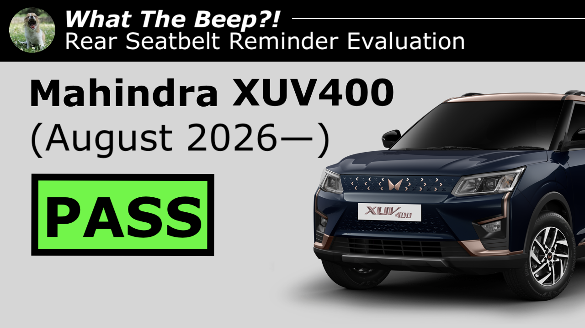
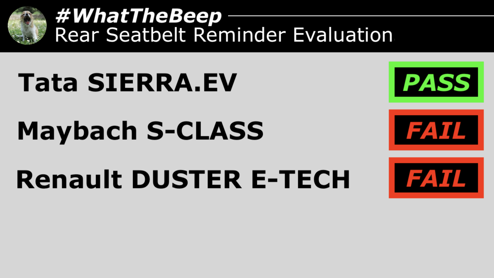
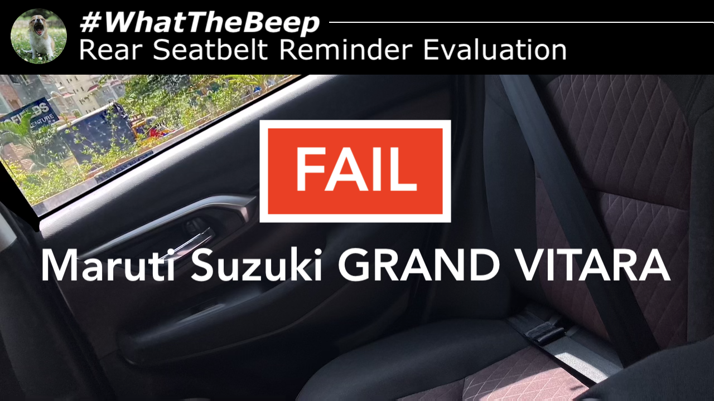
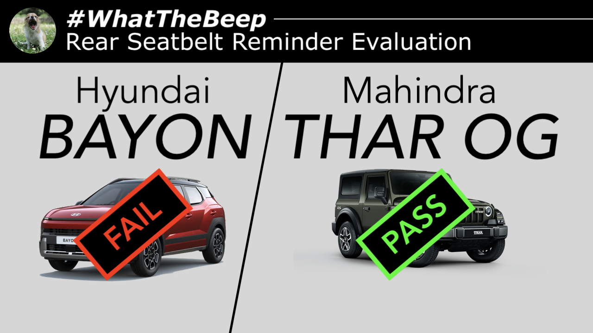

## Latest articles

20.11.2026 **NOTICE** • [Mahindra XUV400 gains intelligent rear seatbelt reminder](articles/N202611201/)

| | | |
| --- | --- | --- |
| 14.11.2026 **NOTICE** • [Luxury cars' rear seatbelt reminders not immune to India-specific downgrades](articles/N202611141/) | 30.10.2026 **NOTICE** • [Grand Vitara fails #WhatTheBeep.](articles/N202610301/) | 27.10.2026 **NOTICE** • [Ahead of AEB mandate for Indian cars, simple safety features like rear seatbelt reminders still have room for improvement](articles/N202610271/) |

[View more](articles/)

## Latest #WhatTheBeep evaluations

|  |  |  |
| - | - | - |
| **[Mahindra XUV400 (^)](whatthebeep/2026-11-20-XUV400-ECPro35kWh/)** |  |  |
| **PASS** |  |  |
| 20.11.26 |  |  |
|  |  |  |

[View more](whatthebeep/)
