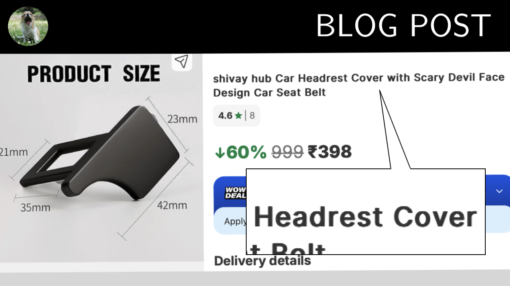
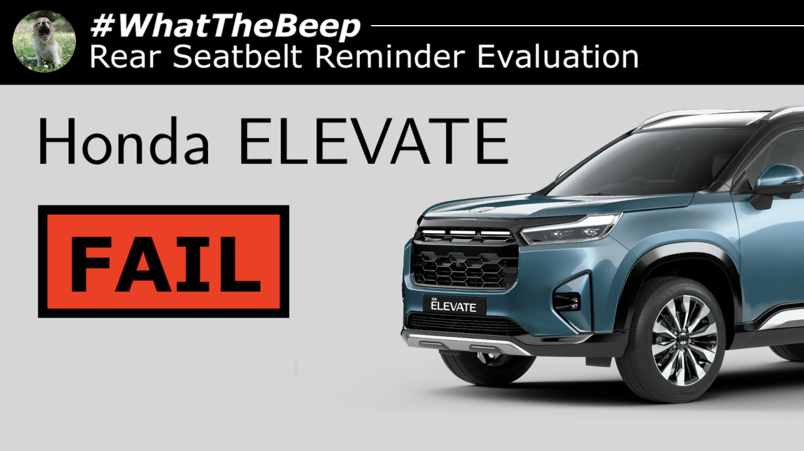
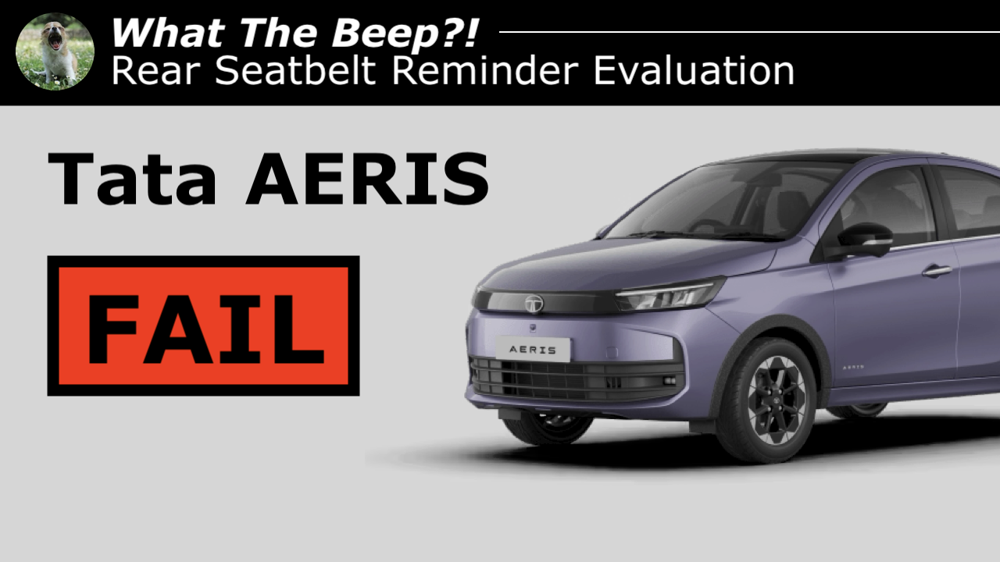

## Latest articles

22.10.2026 **BLOG POST** • [Seatbelt reminder defeat clips continue to be sold under alternative names on India's e-commerce platforms](articles/B202610221/)

| | | |
| --- | --- | --- |
| 15.10.2026 **NOTICE** • [New Toyota GLANZA's poor rear seatbelt reminder receives FAIL in new #WhatTheBeep evaluation](articles/N202610151/) | 07.10.2026 **NOTICE** • [Honda fails to 'Elevate' rear seatbelt reminder in facelifted SUV](articles/N202610071/) | 30.09.2026 **NOTICE** • [Tata Aeris' rear seatbelt reminder awarded FAIL in #WhatTheBeep evaluation](articles/N202609301/) |

[View more](articles/)

## Latest #WhatTheBeep results

- 15.10.26 [Toyota GLANZA (*)](whatthebeep/2026-10-15-GLANZA-E/) — **FAIL**
- 07.10.26 [Honda ELEVATE (*)](whatthebeep/2026-10-07-ELEVATE-SV15iVTEC/) — **FAIL**
- 30.09.26 [Tata AERIS (*)](whatthebeep/2026-09-30-AERIS-Smart12Revotron/) — **FAIL**
- 29.09.26 [Mahindra BOLERO NEO PLUS (*)](whatthebeep/2026-09-29-BOLERONEOPLUS-P420mHawk/) — **PASS**

[View more](whatthebeep/)
