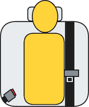
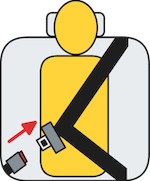
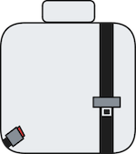
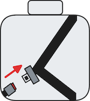

# Mahindra XUV400

### EC Pro 35 kWh • Evaluated on 20.11.26

# **PASS**

[Download datasheet](javascript:window.print();)

## Testcase outcomes

| Testcase                         | Description                            | Audible warning*                            | Verdict                                     |
| -------------------------------- | -------------------------------------- | ------------------------------------------- | ------------------------------------------- |
|  | occupant does not fasten seatbelt      | **YES**  | **OK**   |
|  | occupant takes off seatbelt            | **YES**  | **OK**   |
|  | seatbelt not fastened on an empty seat | **NO**   | **OK**   |
|  | seatbelt taken off on an empty seat    | **NO**   | **OK**   |
|                                  |                                        |                                             | **PASS** |

*final signal in second row outboard seats

## Information Source

### Source Type
desktop research

### Manual URL
[link to manufacturer website](https://mvault.mahindra.com/manual/kaWQpQB6L8lHUHY90_txsg/4-ZO1AnnJ59GLdx8Sqs63A/)

### Brochure URL
[link to manufacturer website](https://auto.mahindra.com/on/demandware.static/-/Sites-amc-Library/default/dw4dc915da/mahindraelectricimages/images/xuv400images/XUV400ProRangeBrochure.pdf)

### Excerpt

    From the XUV400's owners' manual:

    "PODS detects the presence of occupant in the passenger seat.
    Graphic
    If Occupant is present on front passenger and rear passenger seats and not wearing the seat belt, Seat belt reminder warning symbol lamp will glow on the vehicle instrument cluster panel and will be continuous until the seat belt is buckled.
    It should be noted that the PODS require a minimum weight hence children may not be detected by PODS. Along with this warning symbol, a Chime in Cluster will be ON for 95 seconds for front seat belt reminder and 35 seconds for rear passenger seat belt reminder.
    Do keep in mind that after market seat covers also may deteriorate the occupant detection sensor performance, don’t use the non recommended/non authorized seat covers."

[click to go back to #WhatTheBeep](../)
