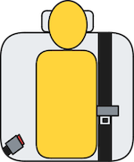
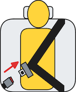
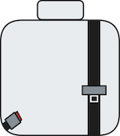
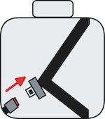

# Tata SIERRA.EV

### Pure 63 kWh RWD • Evaluated on 27.11.26

# **PASS**

[Download datasheet](javascript:window.print();)

## Testcase outcomes

| Testcase                         | Description                            | Audible warning*                            | Verdict                                     |
| -------------------------------- | -------------------------------------- | ------------------------------------------- | ------------------------------------------- |
|  | occupant does not fasten seatbelt      | **YES**  | **OK**   |
|  | occupant takes off seatbelt            | **YES**  | **OK**   |
|  | seatbelt not fastened on an empty seat | **NO**   | **OK**   |
|  | seatbelt taken off on an empty seat    | **NO**   | **OK**   |
|                                  |                                        |                                             | **PASS** |

*final signal in second row outboard seats

## Information Source

### Source Type
desktop research

### Manual URL
[link to manufacturer website](https://ev.tata.cars/content/dam/tml/ev/pdf/owners-manual/sierra-ev/sierra-ev.pdf)

### Brochure URL
[link to manufacturer website](https://ev.tata.cars/content/dam/tml/ev/products/sierra/year-2026/ev/promoting-vc/brochure/july/sierra-ev-brochure.pdf)

### Excerpt

    From the Sierra.ev's' owners' manual:

    "Pg 112
    
    Seat Belt Reminder
    The seatbelt warning indicator remains ON for 4 seconds, when ignition is
    turned ON. The warning lamp remains ON till all **occupied** seats belts are
    buckled.
    If **seatbelt remains unbuckled and vehicle speed goes beyond 15 kmph,
    then final audio warning will go more than 90 seconds**
    Note:Once the seatbelts are fastened, the buzzer and warning lamp turns
    OFF. Seatbelt reminder remains OFF when reverse gear is engaged.

    Pg 132

    Rear Seat Belt Indicator (If equipped)
    If Rear Passenger (Right / Middle / Left) is present and its seat belt is not buckled and IGN is ON then tell tale will be ON as initial warning with No audio
    chime.
    If Rear Passenger (Right / Middle / Left) seat belt remains unbuckled and vehi-
    cle speed goes above 15 km/ hr, Then Seat belt tell tale will also start flashing
    along with audio alarm during Final Warning.
    Note: Buckle the Rear Passenger (Right / Middle / Left) seat belt to stop Audible
    warning and tell tale OFF

    Pg 139

    Rear Seat Belt reminder
    **If Rear Passenger is present & its seat belt re-
    mains unbuckled and vehicle speed goes above
    15 km/ hr, Final Warning will start.**
    
    Audio Chime will continue for 93 seconds.
    Seat belt tell-tale will remain continuously
    ON when audio alarm is active."

[click to go back to #WhatTheBeep](../)
